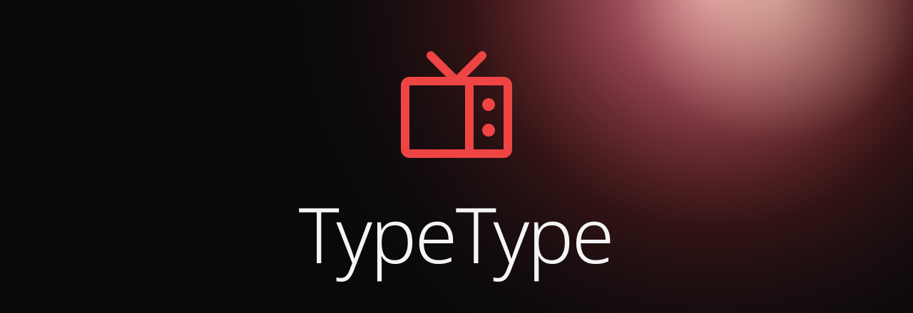
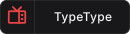
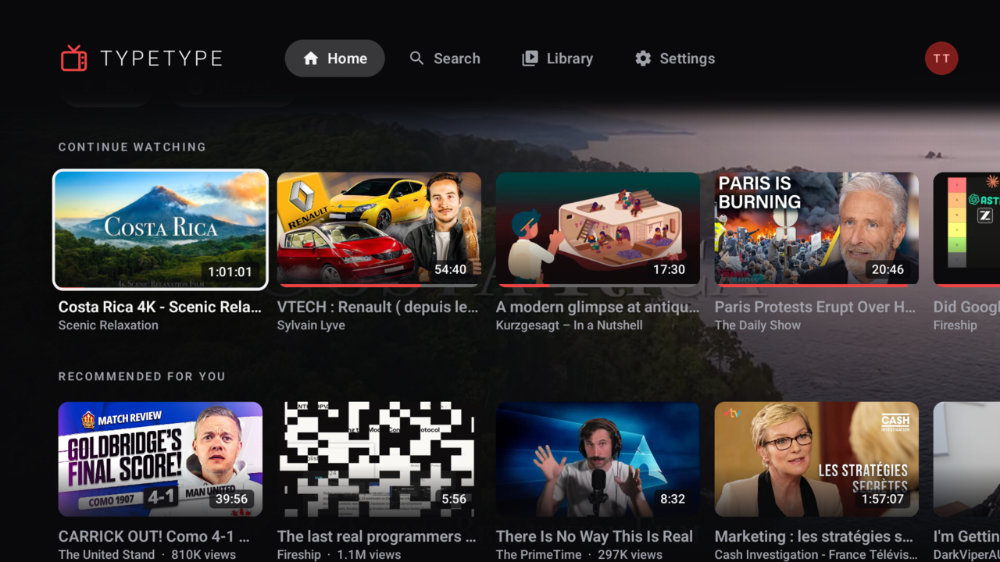
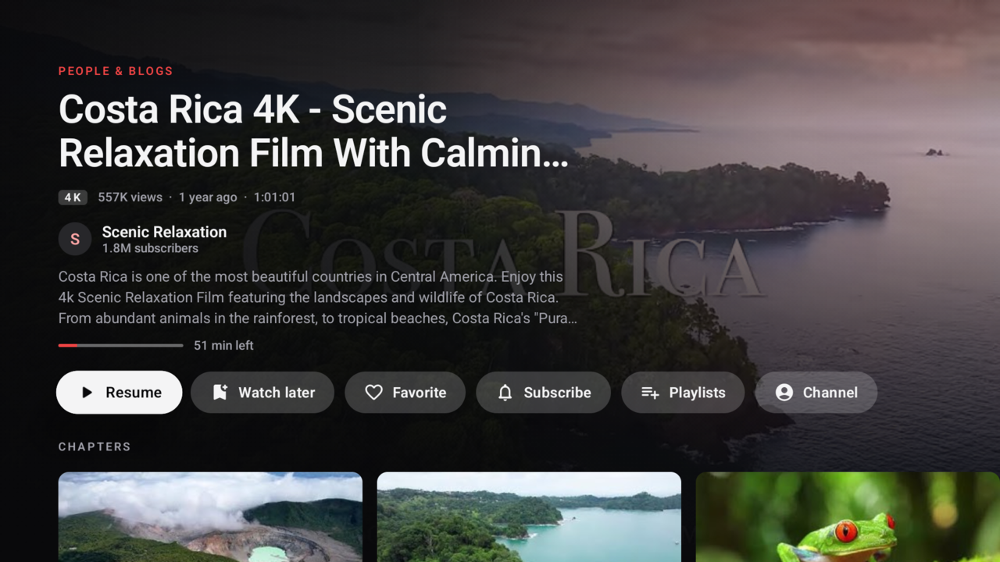
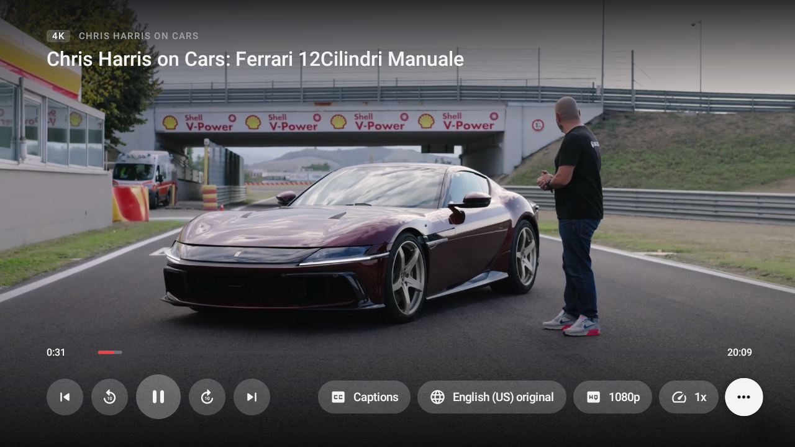
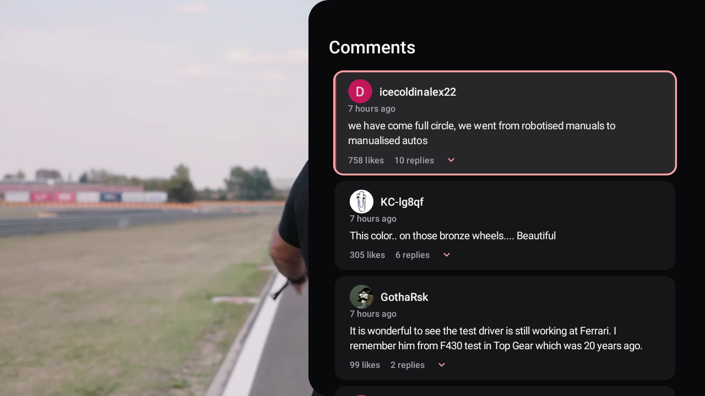
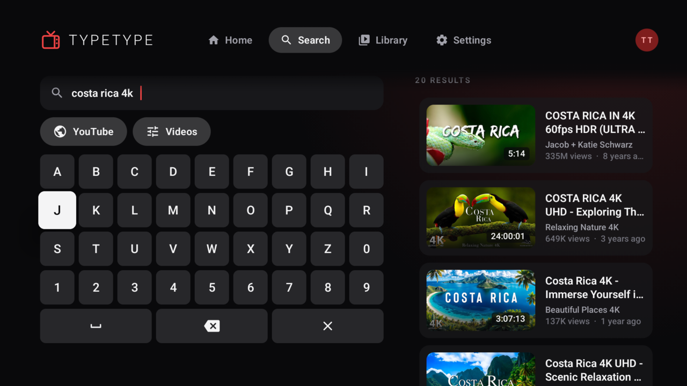
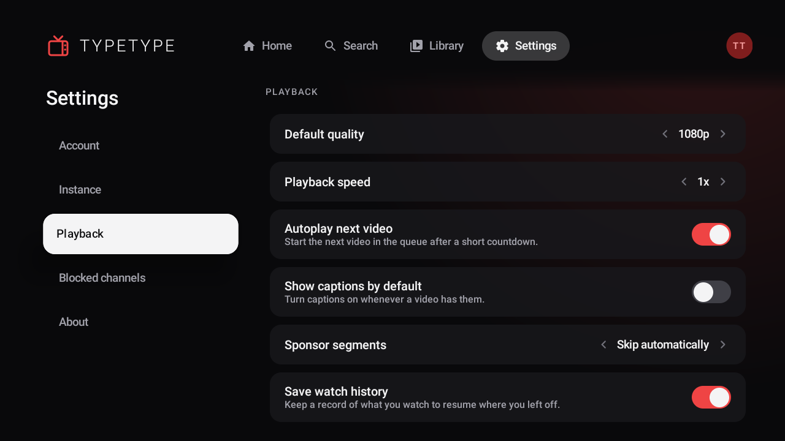

<!-- markdownlint-disable MD033 MD041 -->

<div align="center">
  
  <h1>TypeType TV</h1>
  <p>Native Android TV client for TypeType.</p>
</div>

<div align="center">

[](LICENSE)
[](https://github.com/TypeType-Video/TypeType)

</div>

You want to know the current position of TypeType about AI ? Go check [this](https://github.com/TypeType-Video/TypeType/blob/dev/AI_TRANSPARENCY.md).

TypeType TV is the native Android TV client for [TypeType](https://github.com/TypeType-Video/TypeType), a
self-hosted video platform. It is built for the living room: every screen is designed for a remote control, from a
sofa. It runs on Android TV and Google TV devices with Android 6.0 or newer, and does not require Google Play
Services.

The app uses the TypeType Server chosen during setup for extraction, playback sessions, recommendations, and
synchronization. It supports YouTube, Bilibili, and NicoNico.

> [!NOTE]
> TypeType TV is a client for [TypeType-Server](https://github.com/TypeType-Video/TypeType-Server). You need access
> to a compatible TypeType instance.

## Screenshots

| Home | Video details | Player |
| --- | --- | --- |
|  |  |  |

| Comments | Search | Settings |
| --- | --- | --- |
|  |  |  |

## Features

- Browse the home feed, search videos and channels, and open channels and playlists.
- Resume videos and find your history, favorites, and Watch Later in the library.
- Choose the quality, audio language, captions and their style, and the playback speed.
- Use chapters, SponsorBlock, the description, comments and their replies, and the Up next queue.
- Show scrolling comments on Bilibili and NicoNico videos.
- Watch live streams, or keep only the audio.
- Subscribe to channels and add videos to your playlists from the player.

## Build

Requirements: JDK 17 and the Android SDK (`ANDROID_HOME` set).

```sh
./gradlew :app:testDebugUnitTest :app:assembleDebug
```

The project has two modules:

- `app`: the TV interface, built with Compose for remote-control focus, and the client for the TypeType Server API.
- `player`: the Media3 source for TypeType SABR playback.

## Acknowledgements

A big thank you to the team and contributors behind [SmartTube](https://github.com/yuliskov/SmartTube).

## License

TypeType TV is licensed under the [GNU General Public License v3.0](LICENSE).

Copyright © 2026 Priveetee and TypeType contributors.
