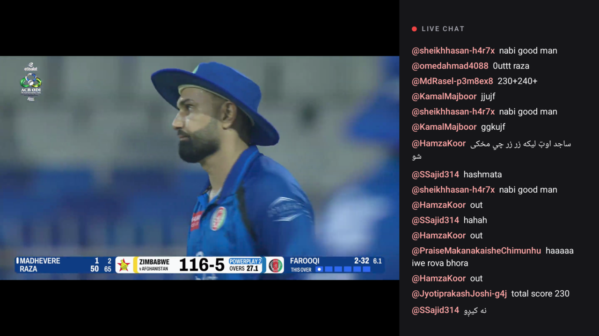
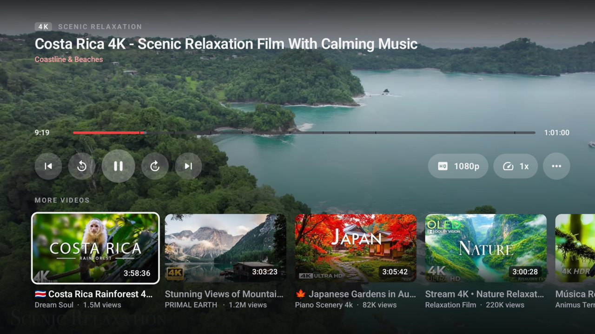

<!-- markdownlint-disable MD033 MD041 -->

<div align="center">
  
  <h1>TypeType TV</h1>
  <p>Native Android TV client for TypeType.</p>
</div>

<div align="center">

[](LICENSE)
[](https://github.com/TypeType-Video/TypeType)

</div>

You want to know the current position of TypeType about AI ? Go check [this](https://github.com/TypeType-Video/TypeType/blob/dev/AI_TRANSPARENCY.md).

TypeType TV is the native Android TV client for [TypeType](https://github.com/TypeType-Video/TypeType), a
self-hosted video platform. It is built for the living room: every screen is designed for a remote control, from a
sofa. It runs on Android TV and Google TV devices with Android 6.0 or newer, and does not require Google Play
Services.

The app uses the TypeType Server chosen during setup for extraction, playback sessions, recommendations, and
synchronization. It supports YouTube, Bilibili, and NicoNico.

> [!NOTE]
> TypeType TV is a client for [TypeType-Server](https://github.com/TypeType-Video/TypeType-Server). You need access
> to a compatible TypeType instance.

## Screenshots

| Home | Video details | Player |
| --- | --- | --- |
|  |  |  |

| Live chat | More videos | Search |
| --- | --- | --- |
|  |  |  |

## Features

- Browse the home feed, search videos, playlists and channels, and open channels and playlists.
- Rest on a video for two seconds to see a muted preview behind the home screen and the video details.
- Resume videos and find your history, favorites, and Watch Later in the library.
- Play up to 4K with AVC, VP9, AV1 or HEVC, chosen from the decoders of your device; HDR on HDR screens.
- Choose the quality, audio language, captions and their style, and the playback speed.
- Use chapters, SponsorBlock, the description, comments and their replies, and the Up next queue.
- Press Down twice in the player to browse more videos without leaving playback.
- Watch YouTube live streams with their chat beside the picture, the live audience, and the quality of your choice.
- Show scrolling comments on Bilibili and NicoNico videos, or keep only the audio.
- Subscribe to channels and add videos to your playlists from the player.

## Build

Requirements: JDK 17 and the Android SDK (`ANDROID_HOME` set).

```sh
./gradlew testDebugUnitTest :app:assembleDebug
```

The project is split into modules:

- `app`: the TV application, its navigation and startup.
- `core:*`: shared resources, the TypeType Server client, playback, the design system, and test fakes.
- `feature:*`: one module per screen family (home, search, library, settings, collections, details, player, sign-in).
- `player`: the Media3 source for TypeType SABR playback.

## Acknowledgements

A big thank you to the team and contributors behind [SmartTube](https://github.com/yuliskov/SmartTube).

## License

TypeType TV is licensed under the [GNU General Public License v3.0](LICENSE).

Copyright © 2026 Priveetee and TypeType contributors.
